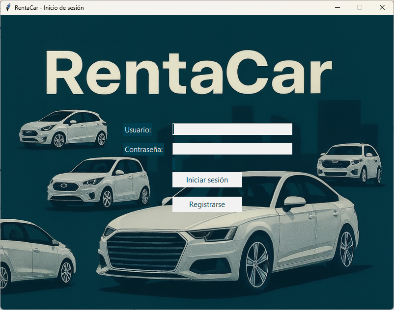
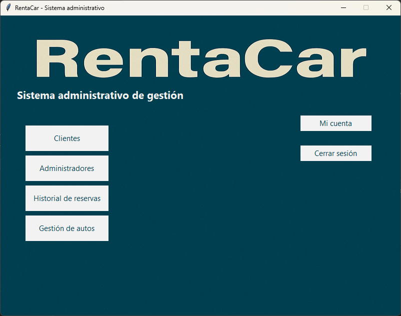
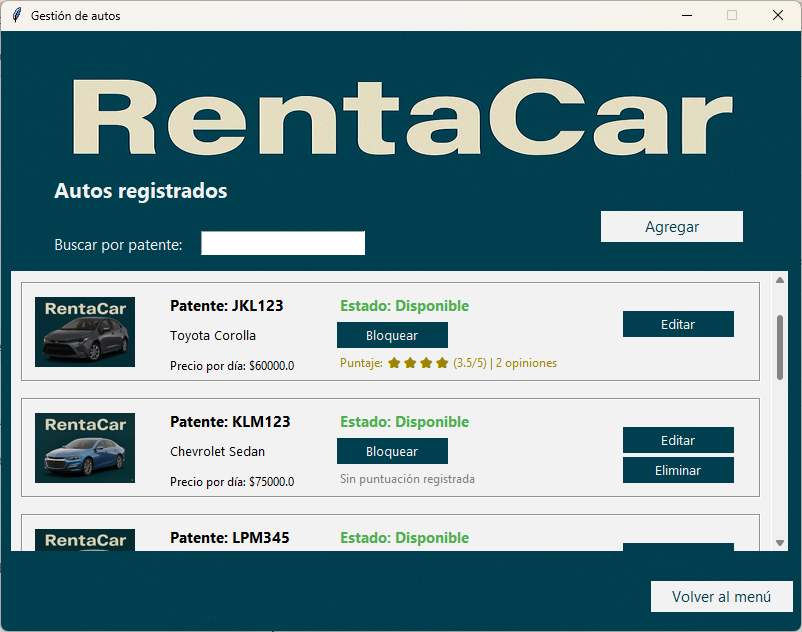
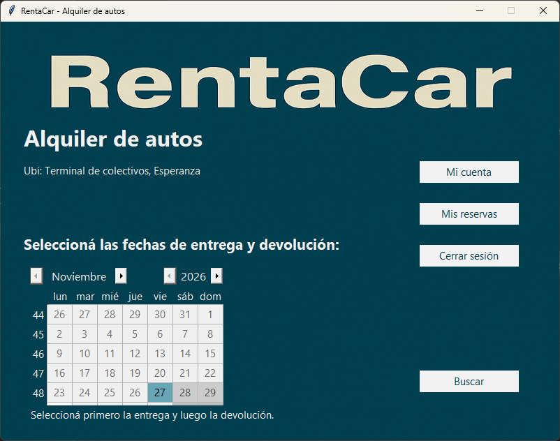
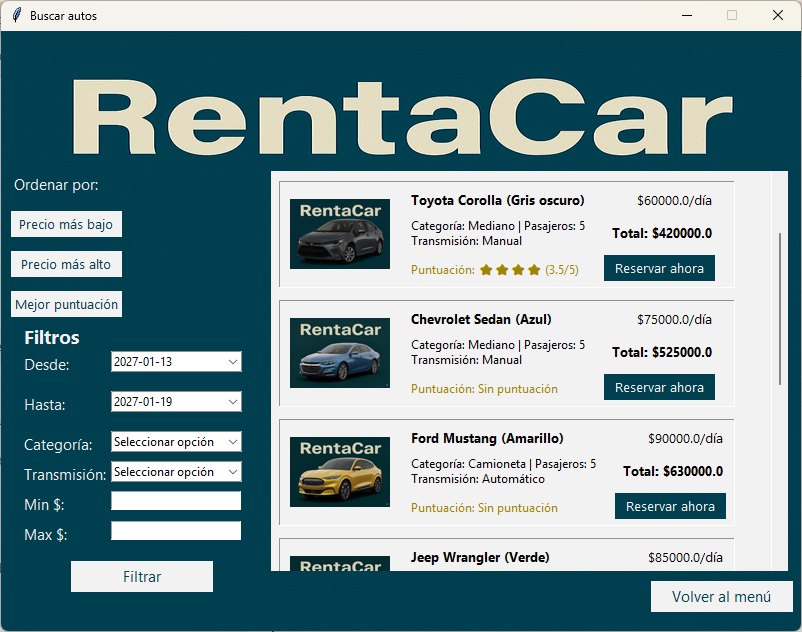
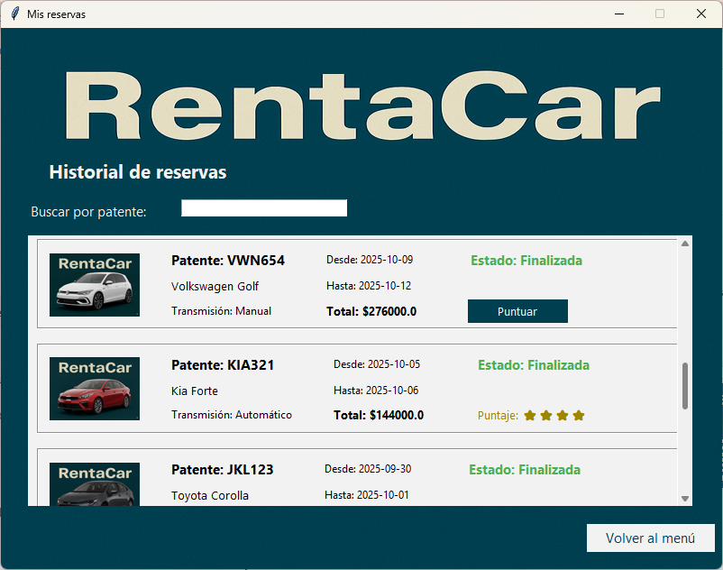
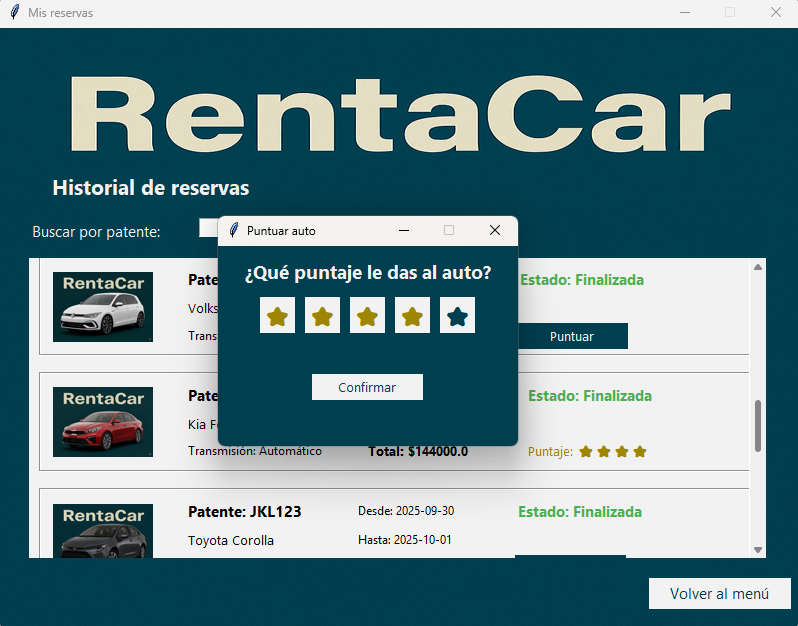

# RentaCar 🚗

**Sistema de alquiler de vehículos | Aplicación de escritorio desarrollada con Python y Tkinter**

RentaCar es un sistema de gestión de alquiler de autos que diseñé y desarrollé para integrar la administración de vehículos, el registro de usuarios y el proceso de reserva en una aplicación de escritorio. Incluye una experiencia diferenciada para clientes y administradores, seguimiento de alquileres y calificaciones de vehículos.

Organicé el proyecto mediante **programación orientada a objetos (POO)** y una arquitectura modular que separa interfaces, entidades, servicios y persistencia. Para la autenticación implementé protección de contraseñas con **PBKDF2-HMAC-SHA256**.

## Vista previa

<p align="center">
  
</p>

### Administración de vehículos

Desde el panel administrativo gestiono clientes y administradores, consulto el historial de alquileres y administro los vehículos registrados, incluyendo sus características, fotografías, disponibilidad y precios.

<table>
  <tr>
    <td align="center" width="50%"><strong>Panel de administración</strong></td>
    <td align="center" width="50%"><strong>Gestión de autos</strong></td>
  </tr>
  <tr>
    <td></td>
    <td></td>
  </tr>
</table>

### Búsqueda y alquiler de vehículos

Los clientes seleccionan un período de alquiler y consultan los vehículos disponibles. La búsqueda ofrece filtros por categoría, transmisión y precio, así como opciones para ordenar los resultados.

<table>
  <tr>
    <td align="center" width="50%"><strong>Selección de fechas</strong></td>
    <td align="center" width="50%"><strong>Búsqueda y filtros</strong></td>
  </tr>
  <tr>
    <td></td>
    <td></td>
  </tr>
</table>

### Historial y calificaciones

Cada cliente puede consultar sus reservas, revisar fechas y estados, y puntuar con **1 a 5 estrellas** un vehículo al finalizar el alquiler.

<table>
  <tr>
    <td align="center" width="50%"><strong>Historial de reservas</strong></td>
    <td align="center" width="50%"><strong>Calificación de vehículos</strong></td>
  </tr>
  <tr>
    <td></td>
    <td></td>
  </tr>
</table>

## Funcionalidades

### Usuarios y autenticación

- Registro e inicio de sesión de clientes.
- Accesos diferenciados para clientes, administradores y administrador general.
- Gestión de clientes y administradores desde sus respectivos paneles.
- Consulta y actualización de datos personales.
- Cambio de contraseña con verificación de la contraseña actual.
- Bloqueo de cuentas desde las funciones administrativas.
- Protección de contraseñas mediante **PBKDF2-HMAC-SHA256**, con sal aleatoria por contraseña y comparación segura de hashes.
- Inicialización del administrador general mediante una variable de entorno, sin contraseñas predeterminadas en el código actual.

### Gestión de vehículos

- Registro, consulta, edición y eliminación de vehículos.
- Administración de marca, modelo, patente, categoría, transmisión, cantidad de pasajeros, color, fotografía y precio diario.
- Bloqueo y desbloqueo de vehículos.
- Configuración de períodos de indisponibilidad desde un calendario.
- Consulta de calificaciones promedio e historial de reservas.

### Reservas y experiencia del cliente

- Selección de fechas de entrega y devolución.
- Consulta de vehículos disponibles en el período seleccionado.
- Filtros por categoría, transmisión y rango de precios.
- Ordenamiento por precio o calificación.
- Creación y cancelación de reservas.
- Consulta de reservas propias, fechas, estados y monto total del alquiler.
- Calificaciones de **1 a 5 estrellas** para alquileres finalizados.

## Tecnologías utilizadas

| Tecnología | Aplicación en el proyecto |
| --- | --- |
| **Python 3.12** | Lógica de negocio y programación orientada a objetos |
| **Tkinter** | Interfaz gráfica de escritorio |
| **tkcalendar** | Calendarios y selección de fechas |
| **Pillow** | Carga y visualización de fotografías |
| **JSON** | Persistencia de datos en archivos locales |
| **hashlib, hmac y secrets** | Hash de contraseñas, verificación y generación de sales |
| **Git y GitHub** | Control de versiones y documentación |

## Estructura del proyecto

Organicé el código separando la presentación, los modelos de dominio y las operaciones del sistema, para facilitar su lectura, mantenimiento y evolución.

```text
RentaCar/
├── clases/                    # Entidades del dominio
├── config/                    # Inicialización del administrador
├── datos/                     # Persistencia JSON local
├── interfaces/
│   ├── administrador/         # Gestión administrativa
│   ├── cliente/               # Búsqueda, reservas y puntuaciones
│   └── comunes/               # Inicio de sesión, registro y cuenta
├── recursos/                  # Estilos y recursos gráficos de la aplicación
├── servicios/                 # Lógica de negocio, validaciones y seguridad
├── capturas/                  # Capturas de pantalla para documentación
├── tests/                     # Pruebas automatizadas
├── main.py                    # Punto de entrada
└── requirements.txt           # Dependencias externas
```

## Instalación y ejecución

**Requisitos:** Python 3.12 con Tkinter disponible, Git y un sistema con entorno gráfico.

1. **Clonar el repositorio:**

   ```bash
   git clone https://github.com/MCammisiMicaela/RentaCar.git
   cd RentaCar
   ```

2. **Instalar las dependencias:**

   ```bash
   python -m pip install -r requirements.txt
   ```

3. **Configurar el administrador inicial** en una instalación nueva. En PowerShell:

   ```powershell
   $clave = Read-Host "Contraseña inicial del administrador" -AsSecureString
   $env:RENTACAR_ADMIN_PASSWORD = [System.Net.NetworkCredential]::new("", $clave).Password
   python main.py
   Remove-Item Env:\RENTACAR_ADMIN_PASSWORD
   ```

   La contraseña debe tener al menos **12 caracteres**, incluyendo letras y números. El nombre de usuario inicial es `admin_general`. Si ese usuario ya existe, no es necesario configurar nuevamente la variable.

4. **Iniciar la aplicación en las siguientes ejecuciones:**

   ```bash
   python main.py
   ```

Los archivos JSON se almacenan localmente en `datos/` y no se incluyen en el repositorio. La configuración privada también está excluida del control de versiones.

## Reglas de negocio

- Verifico los rangos de fechas para evitar superposiciones entre alquileres activos.
- Los vehículos bloqueados o con períodos de indisponibilidad no se ofrecen para esas fechas.
- Las reservas pueden tener estados **activa**, **finalizada** o **cancelada**.
- Las calificaciones se asocian a reservas finalizadas y admiten valores de **1 a 5 estrellas**.
- Las reservas y calificaciones mantienen una asociación con el usuario y el vehículo correspondientes.
- La aplicación contempla compatibilidad con estructuras de datos utilizadas en versiones anteriores del proyecto.

## Pruebas

El proyecto cuenta con pruebas de integración que abarcan autenticación, compatibilidad de vehículos y reservas, creación y cancelación de reservas, persistencia y carga de interfaces.

```bash
python tests/test_integracion.py
```

## Sobre el proyecto

Desarrollé RentaCar como una aplicación práctica para integrar conocimientos de **Python, POO, diseño de interfaces, validaciones, persistencia de datos y lógica de negocio**. Comencé con el circuito de alquiler y calificaciones y posteriormente mejoré la organización del código y la seguridad de autenticación.

---

**Desarrollo:** [Micaela Cammisi](https://github.com/MCammisiMicaela)  
**Repositorio:** [github.com/MCammisiMicaela/RentaCar](https://github.com/MCammisiMicaela/RentaCar)
